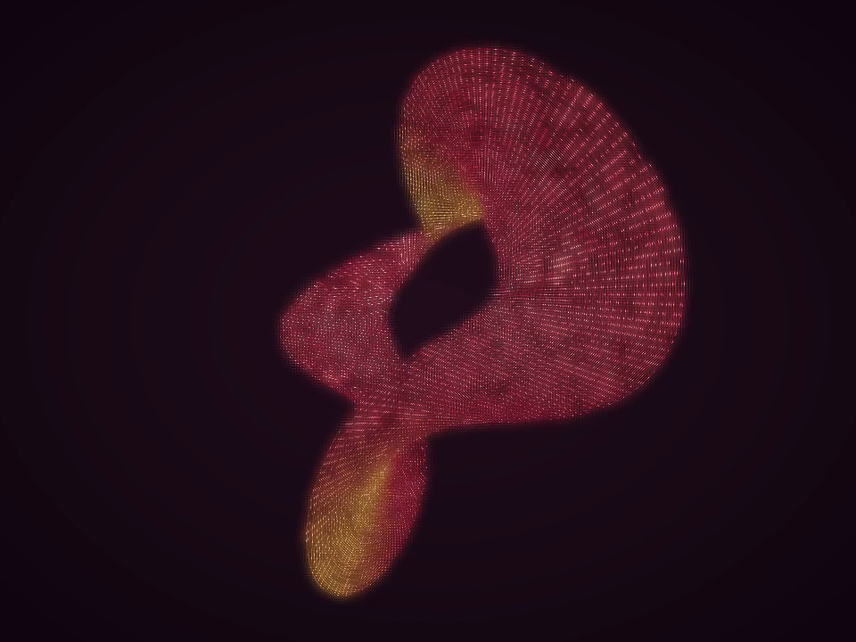

# Framepress

Export a WebGL page to a silent H.264 MP4, advancing the animation one frame at a time. Comes with three original shader studies. Ember is the default.



[Watch the six-second Ember render](media/ember.mp4)

## Run

Requires Node 22+ and installed Google Chrome. FFmpeg downloads automatically with the dependencies.

```sh
npx framepress --demo --out ember.mp4
```

Record your own local page:

```sh
npx framepress http://localhost:3000 --seconds 8 --fps 60 --out demo.mp4
```

Install globally if you prefer:

```sh
npm install -g framepress
framepress --demo
```

## Develop locally

```sh
git clone https://github.com/RajVarsani/framepress.git
cd framepress
npm ci
npm run demo
```

| Option | Default / behavior |
| --- | --- |
| `--demo` | Render a bundled shader study. No server required. |
| `--style` | `ember`; also `indexed` and `phosphor`. Applies to `--demo`. |
| `--out` | `demo.mp4`; existing files protected unless `--force`. |
| `--seconds` | `6`; up to 600, rounded to whole frames. |
| `--fps` | `60`; accepts 1–120. |
| `--width`, `--height` | `1280`, `720`; even dimensions required. |
| `--ready` | Wait for a visible CSS selector, e.g. `--ready canvas`. |
| `--browser` | Chromium executable path. Also accepts `CHROME_PATH`. |

## Frame control

Before loading the page, the recorder replaces main-window `requestAnimationFrame` and `performance.now()`. Every captured frame gets its output timestamp, independent of how long rendering takes. Frames stream into FFmpeg without creating a frame folder. The CLI reports measured rendering speed.

For a scene you own, expose an explicit render hook:

```js
window.__demoRender = (seconds) => {
  mesh.rotation.y = seconds * Math.PI / 3;
  renderer.render(scene, camera);
};
```

The hook may return a promise. It replaces animation callback stepping. Wait for your assets before rendering or use `--ready` with an element your app reveals when loaded. Fonts are awaited automatically.

CSS/Web Animations, native timers, Date, workers, video playback, audio and XR loops are outside the controlled clock. Network data and randomness are not seeded. This is a frame exporter for compatible scenes, not a universal browser-time simulator. Existing page cursors are captured; no pointer is injected.

## Included art

- **Ember:** warm luminous stipples, sparse engraved contours and bloom.
- **Indexed:** quarter-resolution, four-colour ordered dithering.
- **Phosphor:** green surface contours with a moving illumination pulse and bloom.

Original ribbon geometry and shaders. Technical background: [Maxime Heckel's dithering and retro-shading article](https://blog.maximeheckel.com/posts/the-art-of-dithering-and-retro-shading-web/).

## Licence

MIT for this source. Dependencies and the downloaded FFmpeg binary retain their own licences; `ffmpeg-static` provides the binary's licence alongside it.

## Publishing from GitHub Actions

The manual `publish.yml` workflow uses npm trusted publishing with OIDC. Once the package exists on npm, configure its trusted publisher as GitHub user `RajVarsani`, repository `framepress`, workflow `publish.yml`. Then bump the version, push the commit and run the workflow. No npm token is stored in GitHub.
